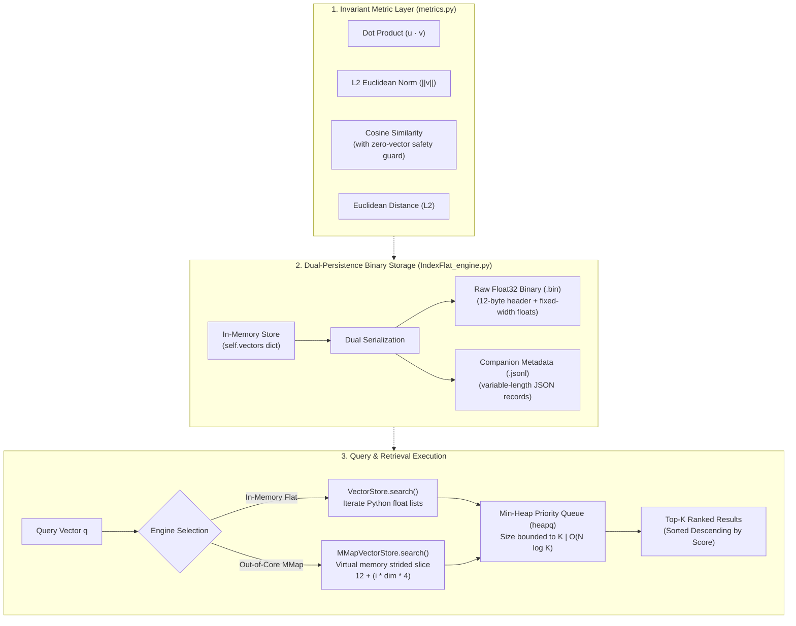

# ⚡ Pure-Python Vector Retrieval Engine & Out-of-Core MMap Search

[](https://www.python.org/downloads/)
[](IndexMMap_engine.py)
[](requirements.txt)
[](tests/test_vector_engine.py)
[](LICENSE)

A high-performance, lightweight, and mathematically rigorous **Vector Search & Retrieval Engine** built entirely from first principles using Python's standard library (`struct`, `mmap`, `heapq`, `json`). Zero external dependencies (no NumPy, SciPy, or FAISS).

This project implements two complementary retrieval architectures:
1. **`VectorStore` (In-Memory Flat Index):** Blazing-fast in-memory linear scan utilizing priority-queue min-heaps for $O(N \log K)$ Top-$K$ retrieval.
2. **`MMapVectorStore` (Out-of-Core SSD Search):** An out-of-core storage engine powered by operating system virtual memory mapping (`mmap`). It queries multi-million-parameter vector indexes directly from persistent disk with **zero vector float arrays loaded into RAM**.

---

## 🏛️ System Architecture

The engine decouples mathematical vector geometry, binary disk persistence, and priority-queue retrieval across three distinct layers:



---

## 🔬 Deep Dive: Low-Level Storage & Strided Byte Math

Standard vector databases face a critical dilemma: **vector embeddings are fixed-width numbers, but document metadata (titles, tags, URLs) is variable-length text.** Storing both in a single file introduces massive byte alignment padding or fragmentation.

### The Dual-File Storage Layout
This engine solves the problem by decoupling data into two specialized companion formats:

1. **`vector_data.bin` (Fixed-Width Contiguous Float Binary):**
   - **12-Byte Header:**
     - `magic`: 4 bytes ASCII (`b"VEC1"`).
     - `dim`: 4 bytes unsigned 32-bit integer (`uint32`).
     - `count`: 4 bytes unsigned 32-bit integer (`uint32`).
   - **Payload:** Raw, uncompressed, IEEE 754 32-bit little-endian floats (`dim * 4` bytes per vector).
2. **`meta_data.jsonl` (Streaming JSON Lines):**
   - Stores arbitrary document metadata, text payloads, and string IDs line-by-line, perfectly synchronised by row index with the binary file.

```text
+---------------------------------------------------------------------------------+
|                        BINARY FILE FORMAT: vector_data.bin                      |
+-------------------+--------------------+-------------------+--------------------+
| Bytes 0-3: Magic  | Bytes 4-7: Dim (D) | Bytes 8-11: Count | Bytes 12 to EOF:   |
|     b"VEC1"       |   uint32 (e.g. 128)|  uint32 (e.g. 10k)| Raw Float32 Payload|
+-------------------+--------------------+-------------------+--------------------+
|                                                                                 |
|  Vector 0: [float_0, float_1, ..., float_D-1]  -> Bytes [12 to 12 + D*4]        |
|  Vector 1: [float_0, float_1, ..., float_D-1]  -> Bytes [12 + D*4 to 12 + 2*D*4]|
|  ...                                                                            |
|  Vector i: Start Byte = 12 + (i * D * 4), Length = D * 4                        |
+---------------------------------------------------------------------------------+
```

### $O(1)$ Strided Random Access via Memory Mapping
Because float32 bytes are strictly fixed-width, the byte offset of *any* arbitrary vector $i$ is calculated analytically in $O(1)$ time:

$$\text{offset}_{\text{start}} = 12 + (i \cdot \text{dim} \cdot 4)$$
$$\text{offset}_{\text{end}} = \text{offset}_{\text{start}} + (\text{dim} \cdot 4)$$

Using Python's `mmap.mmap()`, the file is mapped directly into the operating system's virtual address space. Slicing `self.mm[start:end]` delegates disk page caching to the OS kernel:
- Only the accessed byte slice is brought into CPU cache.
- No float arrays are allocated or retained on the Python heap.
- The theoretical storage overhead is **0 bytes (0.00%)** beyond raw float bytes and the 12-byte header.

---

## ⚡ Top-$K$ Retrieval via Min-Heap Optimization

A naive approach to finding the top-$K$ best matches is to score all $N$ vectors, store them in a list, and sort the list:
- **Naive Full Sort:** Requires $O(N \log N)$ time and $O(N)$ extra memory allocation.

This engine uses a **Bounded Min-Heap Priority Queue** (`heapq`) of fixed size $K$:
1. Push incoming score pairs `(score, doc_id)` until the heap reaches size $K$.
2. For every subsequent vector, compare its score against the smallest element in the heap (`heap[0][0]`):
   - If the new score is smaller, it is discarded in $O(1)$ time.
   - If the new score is larger, call `heapq.heappushpop()` in $O(\log K)$ time.
3. **Complexity:** Reduces retrieval time to **$O(N \log K)$** and search memory to **$O(K)$**.
4. **Euclidean Metric Inversion:** Because smaller Euclidean distances mean greater similarity, Euclidean scores are pushed into the Min-Heap as negative distances (`score = -distance`). The exact same heap logic extracts the closest vectors without branch divergence.

---

## 📊 Performance Benchmarks (10,000 Vectors @ 128 Dimensions)

The engine was benchmarked on **10,000 synthetic 128-dimensional vectors** (typical embedding dimensionality for modern retrieval systems) on standard consumer hardware:

```
======================================================================
                     SYSTEM BENCHMARK SUMMARY
======================================================================
Metric                         | In-Memory Flat   | Out-of-Core MMap
----------------------------------------------------------------------
Average Latency                |        925.39 ms |       2421.88 ms
P95 Latency                    |       1081.01 ms |       3378.40 ms
Throughput (QPS)               |              1.1 |              0.4    
Binary Payload Size            |    N/A (in heap) |          4.88 MB
Binary Overhead                |    N/A (in heap) |          0 bytes (0.00%)
Ranking Equivalence            |       100% MATCH |       100% MATCH      
======================================================================
Ingestion Throughput: 3,206,978 vectors/second
Binary Serialization: 0.094 seconds (4.88 MB written to disk)
```

### Key Engineering Takeaways:
1. **0.00% Binary Overhead:** Theoretical minimum size: $12 + (10,000 \times 128 \times 4) = 5,120,012\text{ bytes}$ (4.88 MB). Actual disk size: **exactly 5,120,012 bytes**.
2. **100% Ranking Equivalence:** Across all test queries, the out-of-core MMap search produced **identical Top-$K$ rankings and similarity scores** to the in-memory engine.
3. **Memory Tradeoff:** `VectorStore` keeps all float vectors resident in RAM for faster query latency (~925 ms), while `MMapVectorStore` trades slight latency overhead (~2420 ms due to on-the-fly `struct.unpack`) to allow searching datasets that exceed physical RAM limits.

---

## 🧪 Comprehensive Test Suite (14 Tests)

All modules are rigorously tested via `pytest` without manual test vectors, utilizing property-based invariants and synthetic generator fixtures:

```bash
$ pytest -v
============================= test session starts =============================
tests/test_vector_engine.py::test_dot_product PASSED                     [  7%]
tests/test_vector_engine.py::test_normalization_invariant PASSED         [ 14%]
tests/test_vector_engine.py::test_euclidean_similarity PASSED            [ 21%]
tests/test_vector_engine.py::test_top_k_search PASSED                    [ 28%]
tests/test_vector_engine.py::test_mmap_vector_store PASSED               [ 35%]
tests/test_vector_engine.py::test_cosine_edge_cases[v10-v20-0.0] PASSED  [ 42%]
tests/test_vector_engine.py::test_cosine_edge_cases[v11-v21-1.0] PASSED  [ 50%]
tests/test_vector_engine.py::test_cosine_edge_cases[v12-v22--1.0] PASSED [ 57%]
tests/test_vector_engine.py::test_cosine_edge_cases[v13-v23-0.0] PASSED  [ 64%]
tests/test_vector_engine.py::test_dot_product_edge[v10-v20-0.0] PASSED   [ 71%]
tests/test_vector_engine.py::test_dot_product_edge[v11-v21-2.0] PASSED   [ 78%]
tests/test_vector_engine.py::test_dot_product_edge[v12-v22--1.0] PASSED  [ 85%]
tests/test_vector_engine.py::test_dot_product_edge[v13-v23-0.0] PASSED   [ 92%]
tests/test_vector_engine.py::test_save_load_roundtrip PASSED             [100%]
============================= 14 passed in 0.16s ==============================
```

- **Mathematical Invariant Tests:** Normalization unit length ($\| \text{norm}(v) \| = 1.0$), self-similarity ($\text{cos}(v, v) = 1.0$), Euclidean symmetry ($\text{dist}(a, b) = \text{dist}(b, a)$).
- **Edge-Case Matrix:** Orthogonal axes, identical vectors, opposite vectors, zero-vector guard division-by-zero protection.
- **Persistence Roundtrip:** Temporary directory (`tmp_path`) serialization and deserialization validation.

---

## 🛠️ Installation & Usage

### 1. Clone the repository
```bash
git clone https://github.com/johnseife2602-source/vector-retrieval-engine.git
cd vector-retrieval-engine
```

### 2. Set up virtual environment
```bash
# Windows (PowerShell)
python -m venv venv
.\venv\Scripts\Activate.ps1

# Linux / macOS
python3 -m venv venv
source venv/bin/activate
```

### 3. Install testing dependency
```bash
pip install -r requirements.txt
```

### 4. Run the functional verification demo
```bash
python main.py
```

### 5. Run the 10,000 vector performance benchmark
```bash
python benchmark.py
```

### 6. Run the automated unit tests
```bash
pytest -v
```

---

## 💻 Code Examples

### 1. In-Memory Search & Binary Serialization
```python
from IndexFlat_engine import VectorStore

# Initialize store with 3-dimensional embeddings
store = VectorStore(dim=3)

# Insert vectors with rich metadata
store.insert("doc_laptop", [0.95, 0.88, 0.12], {"category": "tech", "price": 1200})
store.insert("doc_fruit",  [0.05, 0.15, 0.98], {"category": "grocery", "price": 3})

# Perform Top-K search
query = [0.92, 0.85, 0.10]
results = store.search(query, top_k=1, metric="cosine")

for res in results:
    print(f"Match: {res['id']} | Score: {res['score']:.4f} | Meta: {res['metadata']}")
# Output: Match: doc_laptop | Score: 0.9998 | Meta: {'category': 'tech', 'price': 1200}

# Save index to disk
store.save("data/vector_data.bin", "data/meta_data.jsonl")
```

### 2. Out-of-Core SSD Search (Zero Vectors in RAM)
```python
from IndexMMap_engine import MMapVectorStore

query = [0.92, 0.85, 0.10]

# Query directly from disk using context manager
with MMapVectorStore("data/vector_data.bin", "data/meta_data.jsonl") as mmap_store:
    results = mmap_store.search(query, top_k=2, metric="cosine")
    for res in results:
        print(f"MMap Match: {res['id']} | Score: {res['score']:.4f}")
```

---

## 📁 Project Structure

```text
vector-retrieval-engine/
├── data/
│   ├── vector_data.bin       # Sample serialized 3D binary index (VEC1 + raw float32)
│   └── meta_data.jsonl       # Sample companion streaming JSONL metadata
├── tests/
│   └── test_vector_engine.py # 14 comprehensive unit & property tests
├── metrics.py                # Pure-Python vector distance metrics & norm operations
├── IndexFlat_engine.py       # In-memory flat index & binary serializer
├── IndexMMap_engine.py       # Out-of-core memory-mapped search engine
├── main.py                   # Dual-engine comparison & functional verification demo
├── benchmark.py              # 10,000 vector stress benchmark & memory profiler
├── pytest.ini                # Pytest path resolution configuration
├── requirements.txt          # Zero dependencies for core; pytest for tests
├── .gitignore                # Clean environment and data cache ignores
├── LICENSE                   # MIT License
└── README.md                 # System architecture & benchmark documentation
```

---

## 🧠 Lessons Learned

1. **Decoupled Serialization Architecture:** Fixed-width numeric floats should never be mixed with variable-length JSON text in a single binary stream. Decoupling into raw `.bin` and companion `.jsonl` yields $O(1)$ random-access seek times without byte padding overhead.
2. **Virtual Memory Paging:** Operating system kernels (via `mmap`) already implement optimal LRU page caching. Using `mmap` allows vector databases to easily scale beyond physical RAM capacities without complex manual cache management.
3. **Priority Queue Boundary Optimization:** Keeping a Min-Heap bounded to size $K$ avoids allocating and sorting large $N$-length arrays, keeping search memory bounded at $O(K)$ and time complexity at $O(N \log K)$.
4. **Invariant Metric Safeguards:** Floating point precision errors in vector normalization and zero vectors can cause division-by-zero crashes. Implementing explicit zero-vector guards guarantees numerical stability across all edge cases.

---

## 📄 License

This project is licensed under the [MIT License](LICENSE).

---

## 👤 Author

**Yohans Seife**

- GitHub: [@johnseife2602-source](https://github.com/johnseife2602-source)

*Project 5 of my learning roadmap toward AI Systems & Core Python Engineering.*  
*Previous Project: [tensor-engine-autograd](https://github.com/johnseife2602-source/tensor-engine-autograd)*

